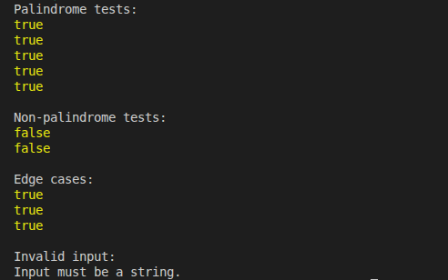

# GMC-Recursion# Low-Level Design: Recursion Checkpoint

A JavaScript exercise that checks whether a word is a palindrome using recursion.

## How It Works

1. **Input validation:** Ensures the input is a string.
2. **Base case:** An empty string or a string containing one character is a palindrome.
3. **Character comparison:** Compares the first and last characters.
4. **Recursive step:** If the characters match, checks the remaining substring.
5. **Termination:** Returns `false` when the characters differ or `true` when the base case is reached.

## Test Screenshots

### Palindrome Tests

## Complexity Analysis

- **Time Complexity:** O(n), where n is the length of the word.
- **Space Complexity:** O(n), due to recursive calls and substring creation.
